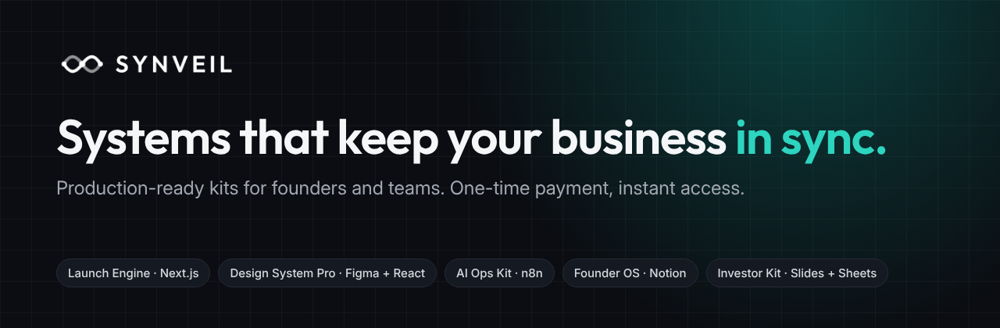
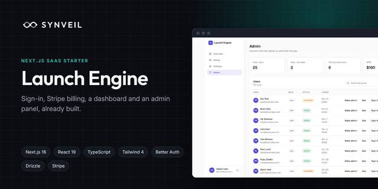
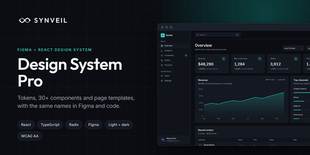
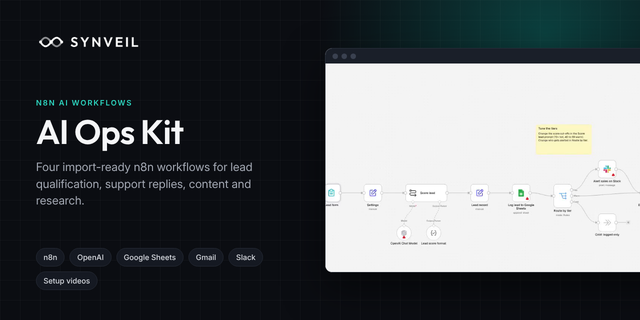
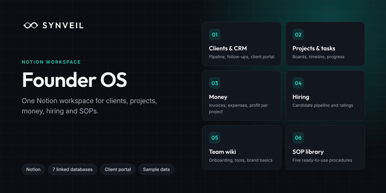
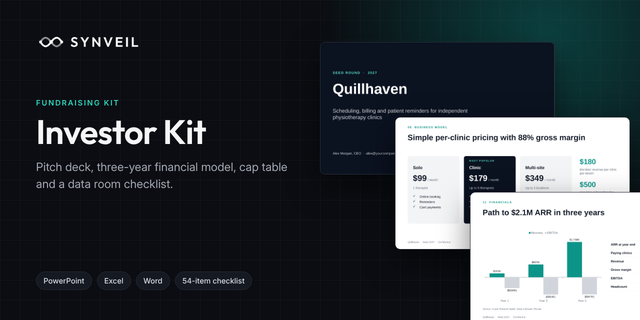

Synveil makes production-ready kits for founders and small teams: the code, designs, workflows and documents you'd otherwise spend weeks building yourself. One-time payment, instant access.

## The kits

| | Kit | What it is | Price |
|---|---|---|---|
|  | [**Launch Engine**](https://github.com/SynveilHQ/launch-engine) | Next.js SaaS starter with sign-in, Stripe billing, a dashboard and an admin panel | $349 |
|  | [**Design System Pro**](https://github.com/SynveilHQ/design-system-pro) | Figma file and React library with matching tokens, 30+ components and page templates | $249 |
|  | [**AI Ops Kit**](https://github.com/SynveilHQ/ai-ops-kit) | Four n8n AI workflows: lead qualification, support replies, content and research | $299 |
|  | [**Founder OS**](https://github.com/SynveilHQ/founder-os) | Notion workspace for clients, projects, money, hiring and SOPs | $149 |
|  | [**Investor Kit**](https://github.com/SynveilHQ/investor-kit) | Pitch deck, three-year financial model, cap table and data room checklist | $199 |

**[Synveil Complete](https://whop.com/synveil/synveil-complete/):** all five kits for $899, $346 less than buying them separately.

Each repo above shows what's inside a kit. The kits themselves are sold and delivered on Whop.

**Website: [synveil.whop.site](https://synveil.whop.site/)**
